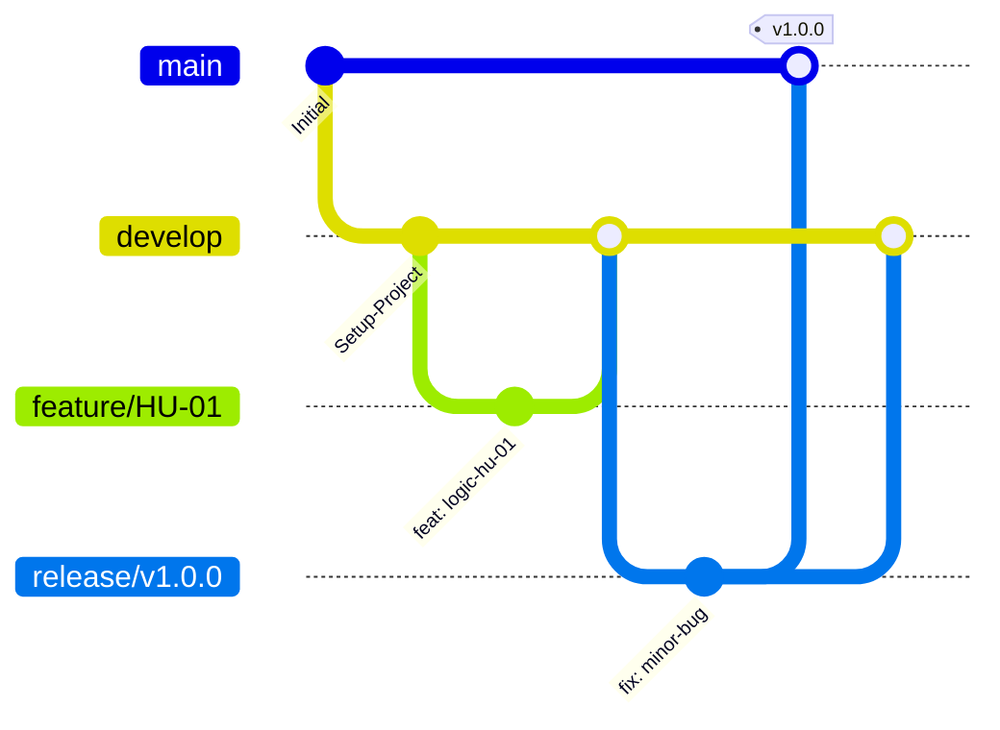

# AgroValle Connect


> El badge de build refleja el pipeline de GitHub Actions definido en `.github/workflows/ci.yml`.
> Estado verificado: `./mvnw clean verify` en verde, Checkstyle sin violaciones y cobertura superior al 60%.

## Visión del Producto

> Para **los productores del Valle del Cauca**, que **necesitan vender directo sin intermediarios excesivos**, **AgroValle Connect** es **una plataforma web desarrollada en Java 17 / Spring Boot** que **conecta la oferta agrícola de las fincas del Valle con la demanda comercial urbana de Cali a precio justo**. A diferencia de **los intermediarios tradicionales**, nuestro producto **garantiza trazabilidad del despacho y contratos de API transparentes entre productor y comprador**.

### El problema

El Valle del Cauca es una despensa agrícola con municipios de alta vocación agrícola como Dagua, Palmira, Buga, Tuluá, Caicedonia y Jamundí, pero la cadena de comercialización tradicional tiene fallas estructurales: intermediación excesiva que baja el precio al productor y lo sube al comprador final, falta de visibilidad en tiempo real de lo que se está cosechando, y ausencia de trazabilidad y programación logística en los despachos.

**AgroValle Connect** elimina la intermediación innecesaria, conectando directamente la oferta agrícola de las fincas del Valle del Cauca con la demanda comercial urbana de Cali y sus alrededores.

### Módulos principales

- **Productores y Ofertas**: registro de fincas por municipio y publicación de cosechas disponibles (cantidad, precio, categoría, fecha estimada de recolección).
- **Catálogo y Búsqueda Inteligente**: filtrado de la oferta por municipio de origen y disponibilidad.
- **Pedidos Directos y Stock**: reserva de inventario, carrito de compra y órdenes de compra directas.
- **Logística y Trazabilidad**: cálculo de fletes por zona y seguimiento del estado del despacho.
- **Panel del Agricultor**: publicaciones, pedidos recibidos y ventas acumuladas en un solo lugar.

## Integrantes del equipo

- Shalom Sofia Vargas Muñoz
- Yeison Andres Cifuentes Reina
- Jadith Milena Saenz Magallanes
- Kevin Andres Balanta Mezu

## Stack Tecnológico

- **Backend**: Java 17, Spring Boot 4.1.1, Spring Data JPA, Maven
- **Base de datos**: PostgreSQL en el perfil `postgres`; H2 en memoria para desarrollo y pruebas
- **Frontend**: HTML5, CSS3 y JavaScript vanilla servidos desde `src/main/resources/static`
- **Arquitectura**: MVC por capas (`controller` → `service` → `repository` → `entity`), con DTOs y patrones Strategy/Factory en fletes
- **Seguridad**: Spring Security con JWT HS256 (Nimbus), BCrypt y autorización por roles/propiedad
- **Calidad**: Checkstyle (Google Java Style), JUnit 5 + MockMvc + JaCoCo (cobertura mínima 60%)
- **Automatización**: GitHub Actions y Husky (pre-commit hooks)

### Organización del código

```text
src/main/java/com/agrovalle/agrovalle_connect/
├── agricultores/   # HU-01, HU-12, HU-15
├── auth/           # Login, registro, JWT y autorización por roles
├── catalogo/       # Municipios y categorías
├── comun/          # Manejo de errores, CORS y respuestas API
├── config/         # Seguridad y datos de ejemplo
├── fletes/         # HU-07 y patrón Strategy
├── pagos/          # HU-06
├── pedidos/        # HU-09, HU-10, HU-11, HU-14
├── productos/      # HU-02, HU-03, HU-04, HU-13
├── resenas/        # HU-08
└── usuarios/       # Registro de compradores
```

## Cómo ejecutar

```bash
# Desarrollo (H2 en memoria + datos de ejemplo)
./mvnw spring-boot:run

# Perfil PostgreSQL (requiere una base de datos disponible)
./mvnw spring-boot:run -Dspring-boot.run.profiles=postgres

# Verificación completa (Checkstyle + tests + cobertura)
./mvnw clean verify

# Empaquetar y ejecutar el JAR
./mvnw clean package
java -jar target/agrovalle-connect-1.0.0.jar
```

También se puede levantar todo con Docker Compose:

```bash
docker compose up --build
```

La aplicación queda disponible en `http://localhost:8080`:

| Página | Descripción |
| --- | --- |
| `/` | Catálogo con búsqueda inteligente, filtros por municipio/categoría/disponibilidad, precios promedio regionales, carrito de compra, contacto directo con el productor y reseñas. |
| `/publicar.html` | Registro de agricultores y publicación de productos. |
| `/pedidos.html` | Consulta del estado de un pedido, línea de tiempo, avance de estado y notificaciones. |
| `/panel.html` | Panel del agricultor con publicaciones, pedidos recibidos y ventas acumuladas (HU-15). |
| `/login.html` | Inicio de sesión, registro de compradores y registro de agricultores con cuenta. |

La consola de H2 está disponible en `/h2-console` (JDBC URL `jdbc:h2:mem:agrovalle`, usuario `sa`).

### Variables de entorno

| Variable | Valor por defecto | Descripción |
| --- | --- | --- |
| `SPRING_PROFILES_ACTIVE` | `default` | Usa `postgres` para conectar con PostgreSQL |
| `SPRING_DATASOURCE_URL` | `jdbc:postgresql://localhost:5432/agrovalle` | URL de la base de datos |
| `SPRING_DATASOURCE_USERNAME` | `postgres` | Usuario de la base de datos |
| `SPRING_DATASOURCE_PASSWORD` | `postgres` | Contraseña de la base de datos |
| `APP_CORS_ALLOWED_ORIGINS` | `http://localhost:8080` | Orígenes permitidos, separados por coma |
| `APP_JWT_SECRET` | Secreto de desarrollo | Clave HS256 de al menos 32 caracteres. **Obligatoria en el perfil `postgres`.** |

## API REST (`/api/v1`)

| Método | Endpoint | Historia de Usuario |
| --- | --- | --- |
| `POST` | `/agricultores` | HU-01 Registro de Agricultores |
| `GET` / `PUT` | `/agricultores`, `/agricultores/{id}` | HU-12 Editar Perfil |
| `GET` | `/agricultores/{id}/panel` | HU-15 Panel del Agricultor |
| `POST` | `/productos` | HU-02 Publicación de Productos |
| `GET` | `/productos?q=&municipio=&categoria=&disponible=` | HU-04 / HU-13 Búsqueda y Filtros |
| `GET` | `/precios/promedio?categoria=CAFE` | HU-03 Precios Regionales |
| `POST` | `/pedidos` | HU-09 / HU-11 Pedido y Descuento de Stock |
| `GET` | `/medios-pago` | HU-06 Medios de Pago |
| `GET` | `/pedidos`, `/pedidos/{id}` | HU-10 Estado del Pedido |
| `PATCH` | `/pedidos/{id}/estado` | HU-10 / HU-14 Cambio de Estado y Notificación |
| `GET` | `/pedidos/{id}/notificaciones` | HU-14 Notificaciones |
| `POST` / `GET` | `/resenas`, `/resenas?agricultorId=` | HU-08 Satisfacción y Reseñas |
| `GET` | `/catalogo/municipios`, `/catalogo/categorias` | Catálogo del Valle |
| `POST` | `/fletes/calcular` | HU-07 Cálculo de Transporte |
| `POST` | `/usuarios` | HU-12 Registro de Compradores |
| `POST` | `/auth/login` | Inicio de sesión (token JWT) |
| `GET` | `/auth/me` | Cuenta autenticada |
| `POST` | `/auth/registro/comprador` | Registro de comprador con cuenta |
| `POST` | `/auth/registro/agricultor` | Registro de agricultor con cuenta vinculada |

### Autenticación y roles

La API usa **JWT stateless** (HS256). El login devuelve `{ token, tokenType: "Bearer", expiresInSeconds, usuario }`
y las peticiones protegidas deben enviar la cabecera `Authorization: Bearer <token>`.

| Rol | Puede |
| --- | --- |
| Público (sin token) | Consultar catálogo, productos, precios, medios de pago, reseñas y fletes; registrarse e iniciar sesión. |
| `COMPRADOR` | Crear pedidos, ver sus pedidos y notificaciones, y crear reseñas. |
| `AGRICULTOR` | Todo lo del comprador, publicar productos, editar su perfil, ver su panel y cambiar el estado de los pedidos de sus productos. |
| `ADMIN` | Acceso completo a productos, pedidos, agricultores y panel. |

Las cuentas demo del perfil de desarrollo son `comprador@agrovalle.co` / `Demo1234*`,
`agricultor@agrovalle.co` / `Demo1234*` y `admin@agrovalle.co` / `Admin1234*`.
Las lecturas de catálogo siguen siendo públicas; publicar, comprar, reseñar y consultar pedidos exige token.

Los errores siguen el formato `{ timestamp, status, error, message, path, fieldErrors }`.
Cada pedido queda asociado a las tablas del DER `MEDIOS_PAGO` (efectivo, transferencia, tarjeta) y `PAGOS`
(monto `NUMERIC(12,2)`, estado y fecha de pago); el medio se selecciona al confirmar el pedido (HU-06).

### Alcance actual y siguientes pasos

Implementado y verificado:

- Registro de agricultores y compradores, catálogo, filtros, precios promedio, carrito y pedidos.
- Descuento automático de stock, estados, notificaciones, reseñas y panel del agricultor.
- Cálculo de fletes con patrón Strategy y datos de ejemplo para desarrollo.
- Autenticación JWT con roles (`ADMIN`, `AGRICULTOR`, `COMPRADOR`), autorización por propiedad y frontend de login.

Siguientes pasos recomendados:

- Migraciones de base de datos con Flyway o Liquibase para reemplazar `ddl-auto=update`.
- Integrar el costo de flete en el checkout y desplegar la aplicación en un entorno público.
- Reponer stock al cancelar un pedido, edición/eliminación de productos y concurrencia de stock.

## Estrategia de Ramas: GitFlow

Elegimos **GitFlow** porque el proyecto está pensado para entregas versionadas a lo largo del curso (incrementos funcionales por sesión) y no para despliegue continuo diario. GitFlow nos da ramas aisladas por funcionalidad y por release, lo que:

- Permite trabajar varias Historias de Usuario en paralelo (una rama `feature/` por HU) sin que el trabajo incompleto de un integrante bloquee a los demás.
- Facilita el control de calidad: cada `feature` pasa por Pull Request y Code Review antes de integrarse a `develop`, y cada `release` se estabiliza antes de llegar a `main`.
- Da trazabilidad clara del historial mediante tags de versión (`v1.0.0`, etc.), útil para la entrega y evaluación de cada incremento.

El costo de GitFlow —mayor complejidad de ramas y posible acumulación de deuda si una rama vive demasiado tiempo— lo mitigamos manteniendo las ramas `feature/` de corta duración y sincronizando frecuentemente con `develop`.



## Convención de Commits

Usamos [Conventional Commits](https://www.conventionalcommits.org/) ligados a Versionamiento Semántico:

- `feat:` nueva funcionalidad (incrementa MINOR)
- `fix:` corrección de error (incrementa PATCH)
- `docs:` / `style:` / `refactor:` / `test:` / `chore:` no afectan la versión pública
- `BREAKING CHANGE:` cambio que rompe compatibilidad (incrementa MAJOR)

Ejemplo: `feat(estudiantes): implementar logica de validacion de correo institucional`

## Calidad y Automatización

Husky y Checkstyle reducen la deuda técnica antes de escribir lógica de negocio: el hook `.husky/pre-commit` ejecuta `./mvnw test` y `./mvnw checkstyle:check` en cada commit. El workflow `.github/workflows/ci.yml` ejecuta `./mvnw verify` en cada cambio de `main` y en cada Pull Request; además, JaCoCo exige una cobertura mínima del 60%.

Para activar Husky localmente, cada integrante debe ejecutar `npm install` desde la raíz del repositorio.


## Tablero Kanban y Políticas Explícitas
 
El equipo gestiona el flujo de trabajo de cada sprint en un tablero de **GitHub Projects** vinculado a este repositorio.

**Tablero:** [GitHub Projects del repositorio](https://github.com/kbalantamezu-ops/AgroValle-Connect/projects)

**Issues:** [Historias de usuario y tareas](https://github.com/kbalantamezu-ops/AgroValle-Connect/issues)
 
### Columnas y límites de trabajo en progreso (WIP Limits)
 
| Columna | Límite WIP | Regla de entrada | Regla de salida |
|---|---|---|---|
| **Product Backlog** | Sin límite | Historia de Usuario (HU) con prioridad MoSCoW y puntos Fibonacci asignados | La HU se selecciona en el Sprint Planning |
| **Sprint Backlog (To Do)** | Sin límite | Tarea técnica de máximo 8 horas, vinculada a su HU como sub-issue | Un integrante la toma y crea su rama `feature/*` |
| **In Progress** | **Máximo 3 tareas** | La tarea tiene un responsable y una rama corta (`feature/HUxx-nombre`) | Se abre el Pull Request |
| **Code Review / Testing** | **Máximo 2 Pull Requests** | PR abierto, con `mvn test` y `mvn checkstyle:check` pasando en local | Aprobación explícita de un revisor |
| **Done** | Sin límite | 1 aprobación (Approve), pruebas JUnit 5 en verde y 0 errores de Checkstyle | Merge a `main` |
 
### Políticas explícitas
 
1. **Regla de Done:** Ninguna tarjeta se mueve a *Done* si el Pull Request no cuenta con la aprobación de al menos un revisor (Peer Review), las pruebas JUnit 5 pasando y 0 errores de Checkstyle.
2. **Cumplimiento del DoD:** Toda tarjeta en *Done* cumple el Definition of Done definido en [`docs/dod.md`](docs/dod.md).
3. **Respeto del WIP:** Si una columna alcanza su límite, ningún integrante toma una tarjeta nueva hasta que se libere un cupo. Primero se apoya en terminar el trabajo en curso.
4. **Flujo sin saltos:** Ninguna tarjeta omite columnas. Todas pasan por *Code Review / Testing* antes de *Done*.
5. **Revisión cruzada:** Ningún integrante aprueba su propio Pull Request. El revisor es siempre una persona distinta al autor.
6. **Contenido del Pull Request:** Cada PR describe los escenarios BDD probados y adjunta evidencia de las pruebas ejecutadas.
7. **Convención de ramas y commits:** Cada tarea se desarrolla en una rama corta (`feature/HUxx-nombre`) y los commits siguen Conventional Commits (`feat`, `fix`, `test`).
8. **Unidad de trabajo del tablero:** Las tarjetas que avanzan por las columnas son las tareas técnicas (`T-xx.xx`). Las HUs se consideran terminadas cuando todas sus sub-issues están en *Done*.
 

