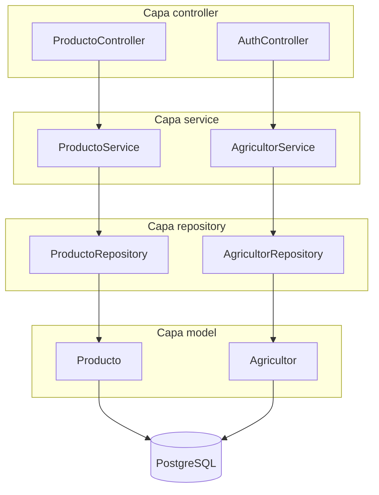
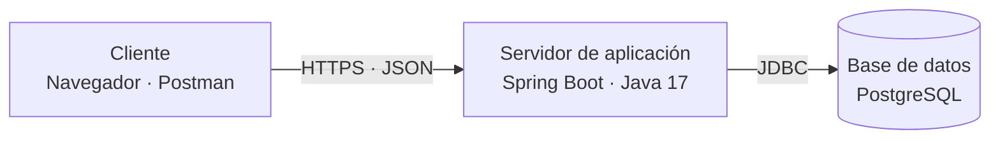
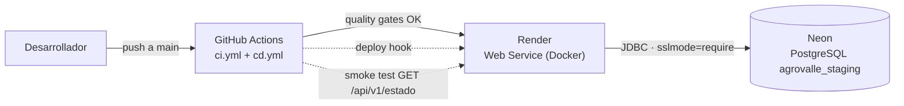
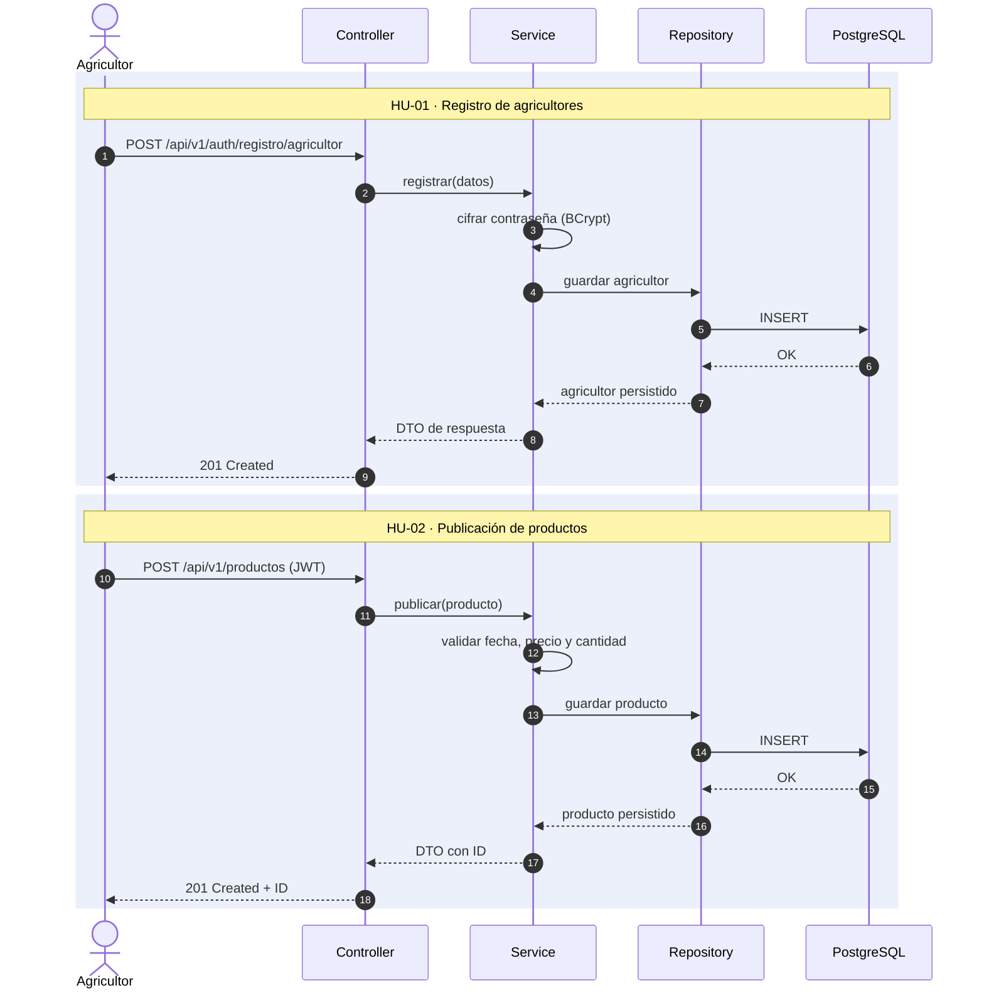
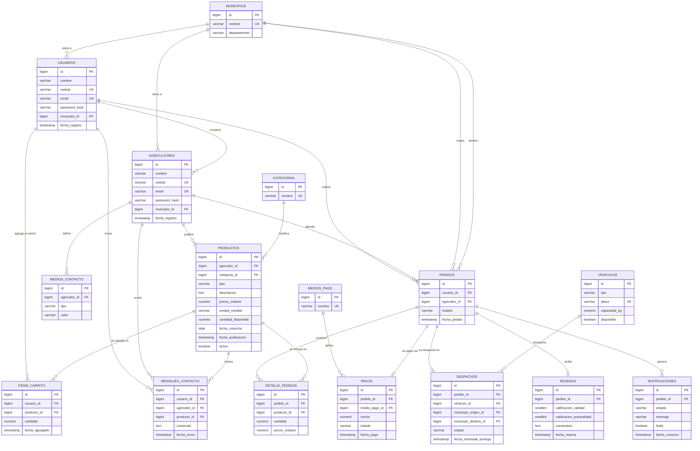
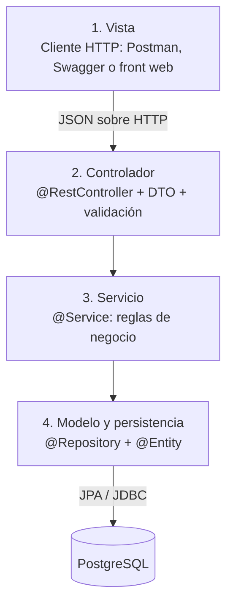

# Diagramas UML AgroValle-Connect

# Diagrama de Componentes

Muestra la separación de AgroValle Connect en las cuatro capas del patrón MVC y
las dependencias permitidas entre ellas. Cada capa solo conoce a la inmediatamente
inferior: **controlador → servicio → repositorio → modelo/persistencia**.

# Diagrama de Despliegue

## 1. Despliegue lógico

Vista general de los nodos que participan en una petición: el cliente, el servidor
de aplicación Spring Boot y la base de datos PostgreSQL.

## 2. Despliegue en Staging (Sprint 3)

El ambiente de preproducción se despliega automáticamente desde la rama `main`.

# Diagrama de Secuencia

Flujos de registro de agricultores (HU-01) y publicación de productos (HU-02) a
través de las cuatro capas.

# Diagrama Entidad-Relación (DER)

Modelo de datos de AgroValle Connect en Tercera Forma Normal (3FN). Cada tabla
tiene llave primaria simple y las dependencias entre entidades se resuelven con
llaves foráneas, sin grupos repetitivos ni dependencias transitivas.

# Arquitectura MVC en 4 Capas

Vista de paquetes y capas de la aplicación. La "vista" es el cliente HTTP que
consume la API REST; el controlador valida, el servicio aplica las reglas de
negocio y el modelo/repositorio persiste en PostgreSQL.

