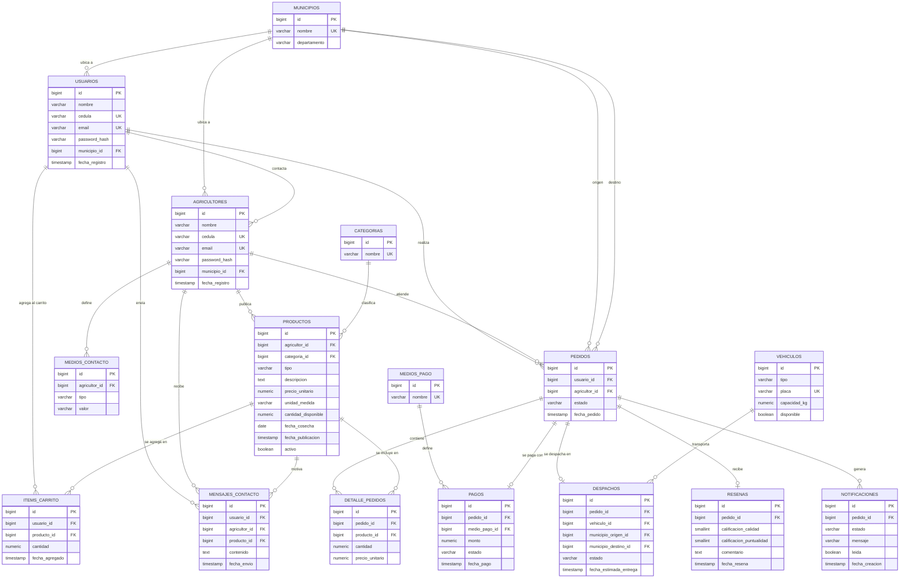

# Diagrama Entidad-Relación (DER)

Modelo de datos de AgroValle Connect en Tercera Forma Normal (3FN). Cada tabla
tiene llave primaria simple y las dependencias entre entidades se resuelven con
llaves foráneas, sin grupos repetitivos ni dependencias transitivas.

## Justificación de la 3FN

- **1FN:** todos los atributos son atómicos y cada tabla tiene llave primaria. Los
  productos de un pedido van en `DETALLE_PEDIDOS`, no en columnas `producto1`,
  `producto2`.
- **2FN:** todas las tablas usan llave primaria simple (`id`), por lo que ningún
  atributo depende de solo una parte de la llave.
- **3FN:** no hay dependencias transitivas. El nombre del municipio y el de la
  categoría viven en sus propias tablas y se referencian por FK.
- **Decisión de diseño:** `DETALLE_PEDIDOS.precio_unitario` guarda una copia del
  precio al momento de la compra. No es redundancia que viole la 3FN, sino un dato
  histórico: si el productor cambia el precio mañana, el pedido antiguo no cambia.

## Correspondencia con el esquema de Staging

`docs/diseno/schema.sql` es la versión simplificada que se ejecuta en Neon para el
laboratorio de Despliegue Continuo (tablas `agricultores`, `usuarios`, `productos`,
`pedidos`, `items_pedido`, `pagos`, etc.). El DER de este documento es el modelo de
diseño completo y canónico.

> Fuente original: `docs/architecture/images/modelo-entidad-relacion.png` y
> [`docs/architecture/images/modelo-datos-der.png`](modelo-datos-der.png).
> Ver también [`docs/diseno/modelo-datos.md`](../../diseno/modelo-datos.md).
