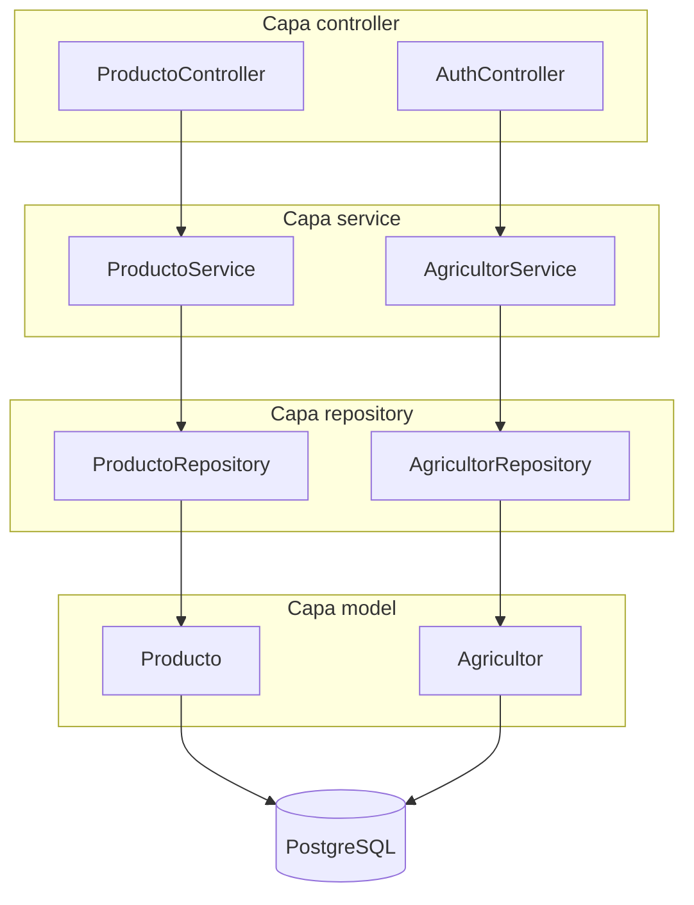

# Diagrama de Componentes

Muestra la separación de AgroValle Connect en las cuatro capas del patrón MVC y
las dependencias permitidas entre ellas. Cada capa solo conoce a la inmediatamente
inferior: **controlador → servicio → repositorio → modelo/persistencia**.

## Responsabilidad de cada componente

| Componente | Capa | Responsabilidad |
| --- | --- | --- |
| `AuthController` | Controller | Expone el registro y el login; valida DTO y devuelve HTTP. |
| `ProductoController` | Controller | Expone el catálogo y la publicación/edición de productos. |
| `AgricultorService` | Service | Reglas de registro, unicidad de cédula/correo y cifrado BCrypt. |
| `ProductoService` | Service | Reglas de publicación, stock, precios y filtros del catálogo. |
| `AgricultorRepository` | Repository | Acceso JPA a la tabla `agricultores`. |
| `ProductoRepository` | Repository | Acceso JPA a la tabla `productos` y consultas de búsqueda. |
| `Agricultor` / `Producto` | Model | Entidades del dominio mapeadas al DER. |
| PostgreSQL | Persistencia | Base de datos relacional en 3FN (Neon en Staging). |

## Reglas de dependencia

1. El controlador nunca accede directamente a un repositorio.
2. Las entidades no se exponen en la API: se usan DTO (`RegistroAgricultorRequest`,
   `ProductoResponse`, etc.).
3. Las reglas de negocio viven en los servicios para poder probarlas con JUnit
   sin levantar la base de datos.

> Fuente original: `docs/diseno/diagrama-componentes (1).png` y
> [`docs/diseno/arquitectura-mvc-gof.md`](../diseno/arquitectura-mvc-gof.md).
