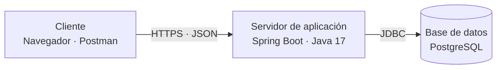
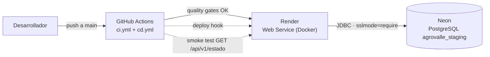

# Diagrama de Despliegue

## 1. Despliegue lógico

Vista general de los nodos que participan en una petición: el cliente, el servidor
de aplicación Spring Boot y la base de datos PostgreSQL.

| Nodo | Tecnología | Comunicación |
| --- | --- | --- |
| Cliente | Navegador web, Postman o Swagger | HTTPS con cuerpos JSON |
| Servidor de aplicación | Spring Boot 4 / Java 17, empaquetado en Docker | JDBC hacia PostgreSQL |
| Base de datos | PostgreSQL 15/16 | Conexión TLS en Staging |

## 2. Despliegue en Staging (Sprint 3)

El ambiente de preproducción se despliega automáticamente desde la rama `main`.

| Componente | Servicio |
| --- | --- |
| Base de datos | Neon PostgreSQL — `agrovalle_staging` |
| Aplicación | Render Web Service `AgroValle-Connect` (Docker, branch `main`) |
| Orquestación | GitHub Actions — `.github/workflows/cd.yml` |
| Secretos | GitHub Secrets + variables de entorno de Render |

**URL base de Staging:** `https://agrovalle-connect-mrv2.onrender.com`

> Los servicios gratuitos de Render se suspenden por inactividad: el primer request
> puede tardar entre 30 y 60 segundos.

> Fuente original: `docs/diseno/diagrama-despliegue (1).png` y
> [`docs/sprint-3-review.md`](../sprint-3-review.md).
