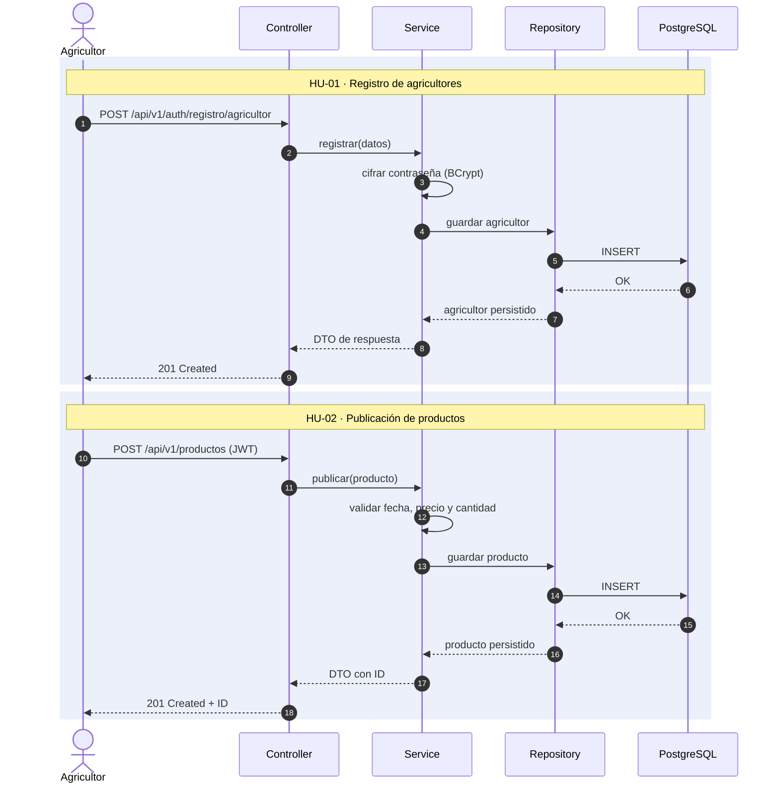

# Diagrama de Secuencia

Flujos de registro de agricultores (HU-01) y publicación de productos (HU-02) a
través de las cuatro capas.

## Notas

- El diagrama original mostraba `POST /api/v1/auth/register`; la ruta realmente
  implementada es `POST /api/v1/auth/registro/agricultor`.
- La publicación de productos exige un token JWT con rol `AGRICULTOR` o `ADMIN`.
- El controlador no conoce el repositorio: delega toda la lógica en el servicio.
- El servicio aplica las reglas de negocio antes de persistir: unicidad de cédula
  y correo, cifrado BCrypt, fechas válidas, precio positivo y stock no negativo.

> Fuente original: `docs/diseno/diagrama-secuencia (1).png`.
