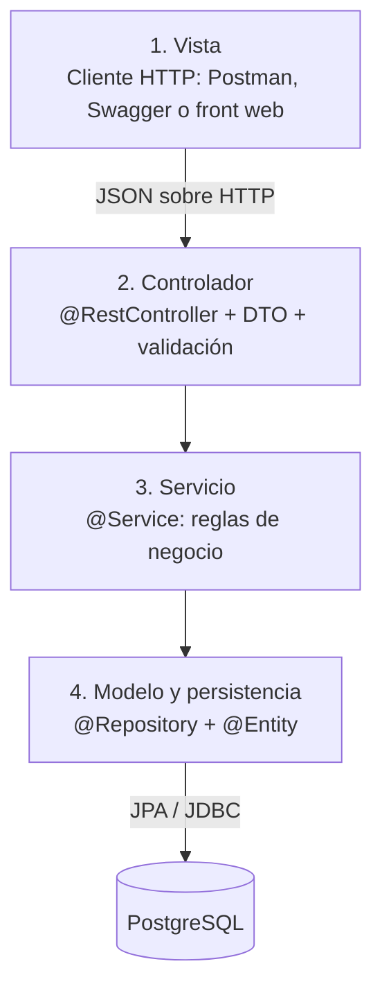

# Arquitectura MVC en 4 Capas

Vista de paquetes y capas de la aplicación. La "vista" es el cliente HTTP que
consume la API REST; el controlador valida, el servicio aplica las reglas de
negocio y el modelo/repositorio persiste en PostgreSQL.



## Estructura de paquetes

```text
com.agrovalle.agrovalle_connect
├── controller/   -> AuthController, ProductoController, PedidoController
├── service/      -> AgricultorService, ProductoService, PedidoService
├── repository/   -> AgricultorRepository, ProductoRepository, PedidoRepository
├── model/        -> Agricultor, Usuario, Producto, Pedido, Municipio, Categoria
├── dto/          -> AgricultorRegistroDTO, ProductoResultadoDTO
└── config/       -> configuración de seguridad y beans
```

> En el código actual la organización es por funcionalidad
> (`agricultores/`, `productos/`, `pedidos/`, etc.), pero cada paquete conserva
> internamente la separación controlador → servicio → repositorio → entidad.

## Reglas de dependencia

1. Cada capa solo conoce a la inmediatamente inferior: Controlador → Servicio →
   Repositorio.
2. El controlador nunca accede directamente a un repositorio.
3. Las entidades no se exponen en la API: se usan DTO, de modo que datos como
   `password_hash` no salen del sistema.
4. Las reglas de negocio viven solo en el servicio para poder probarlas con JUnit
   sin levantar la base de datos.

> Fuente original: [`docs/diseno/arquitectura-mvc-gof.md`](../diseno/arquitectura-mvc-gof.md).
