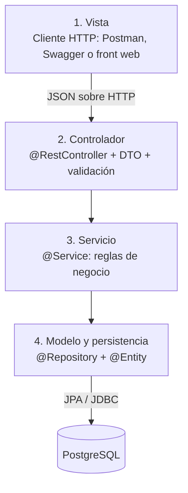

# Arquitectura MVC en 4 Capas y Patrones GoF: AgroValle Connect

Este documento explica cómo se organiza AgroValle Connect (Java 17, Spring Boot, PostgreSQL) en una arquitectura MVC de cuatro capas y qué patrones de diseño del catálogo GoF (Gang of Four) se aplican o se han previsto aplicar.

---

## 1. Arquitectura MVC en 4 capas

El patrón MVC separa la presentación, el control del flujo y los datos. En una aplicación Spring Boot con API REST es habitual dividir además la lógica de negocio en una capa propia, lo que da cuatro capas.



| Capa | Responsabilidad | Tecnología | Ejemplo en HU-01 (Registro de Agricultores) |
|---|---|---|---|
| **1. Vista** | Mostrar datos y recibir las acciones del usuario. En esta etapa la "vista" es el cliente HTTP que consume la API. | Postman, Swagger, futuro front web | Formulario o petición `POST /api/v1/auth/register` |
| **2. Controlador** | Recibir la petición, validar los datos de entrada, delegar en el servicio y devolver la respuesta HTTP. No contiene lógica de negocio. | `@RestController`, DTO, Jakarta Validation | `AuthController` |
| **3. Servicio** | Reglas de negocio: cifrar la contraseña, verificar unicidad, validar fechas, descontar stock. Coordina varios repositorios. | `@Service`, BCrypt | `AgricultorService` |
| **4. Modelo y persistencia** | Entidades del dominio y acceso a datos. Representa las tablas del DER en 3FN. | `@Entity`, `@Repository`, Spring Data JPA | `Agricultor`, `AgricultorRepository` |

### Reglas de dependencia

1. Cada capa solo conoce a la inmediatamente inferior: Controlador → Servicio → Repositorio.
2. El controlador nunca accede directamente a un repositorio.
3. Las entidades no se exponen en la API: el controlador entrega y recibe **DTO**, de modo que datos como `password_hash` no salen del sistema.
4. Las reglas de negocio viven solo en el servicio, para poder probarlas con JUnit sin levantar la base de datos.

### Estructura de paquetes objetivo

```
com.agrovalle.agrovalle_connect
├── controller/   -> AuthController, ProductoController, PedidoController
├── service/      -> AgricultorService, ProductoService, PedidoService
├── repository/   -> AgricultorRepository, ProductoRepository, PedidoRepository
├── model/        -> Agricultor, Usuario, Producto, Pedido, Municipio, Categoria
├── dto/          -> AgricultorRegistroDTO, ProductoResultadoDTO
└── config/       -> configuración de seguridad y beans
```

Esta separación es la que muestran el diagrama de componentes (`diagrama-componentes.png`) y el diagrama de secuencia (`diagrama-secuencia.png`) de esta misma carpeta.

---

## 2. Patrones GoF

Se seleccionaron cuatro patrones que resuelven problemas reales del producto. Dos ya están presentes por el uso de Spring y dos están previstos para historias del backlog.

| Patrón | Categoría GoF | Dónde se usa en AgroValle Connect | Estado |
|---|---|---|---|
| **Singleton** | Creacional | Beans `@Service`, `@Repository` y `@RestController` | Aplicado (Spring) |
| **Facade** | Estructural | Capa de servicio frente a controladores | Aplicado |
| **Strategy** | Comportamiento | Medios de pago (HU-06) | Previsto |
| **Observer** | Comportamiento | Notificaciones de cambio de estado del pedido (HU-14) | Previsto |

### 2.1 Singleton

- **Intención:** garantizar que exista una única instancia de una clase y ofrecer un punto de acceso a ella.
- **Aplicación:** Spring crea por defecto una sola instancia (scope `singleton`) de cada bean. `AgricultorService`, `ProductoRepository` o `AuthController` existen una sola vez y se inyectan donde se necesitan mediante inyección de dependencias.
- **Beneficio:** ahorro de memoria y un único punto de coordinación. Obliga a que los servicios no guarden estado propio de una petición, lo que evita errores de concurrencia entre usuarios.

### 2.2 Facade

- **Intención:** ofrecer una interfaz simple a un conjunto de subsistemas complejos.
- **Aplicación:** `PedidoService` actúa como fachada para HU-09. El controlador llama a un único método (`confirmarPedido`) y el servicio coordina por dentro varios subsistemas: validar el stock de `ProductoRepository`, descontar la cantidad, registrar el `Pedido` con su `detalle_pedido` y dejar el estado inicial.
- **Beneficio:** el controlador queda delgado, la lógica de negocio queda en un solo lugar y es más fácil de probar.

### 2.3 Strategy

- **Intención:** definir una familia de algoritmos intercambiables y elegir uno en tiempo de ejecución.
- **Aplicación prevista (HU-06, Medios de Pago):** cada medio de pago (efectivo, transferencia, tarjeta) implementa una misma interfaz, y el servicio elige la estrategia según el medio que escogió el comprador.

```java
public interface MedioPagoStrategy {
    ResultadoPago pagar(Pedido pedido);
}

@Component
public class PagoTransferencia implements MedioPagoStrategy {
    @Override
    public ResultadoPago pagar(Pedido pedido) {
        // lógica específica de la transferencia
    }
}
```

- **Beneficio:** agregar un nuevo medio de pago no obliga a modificar el código existente (principio abierto/cerrado) y evita un `if/else` largo en el servicio.

### 2.4 Observer

- **Intención:** definir una dependencia uno-a-muchos para que, cuando un objeto cambie de estado, se notifique automáticamente a quienes dependen de él.
- **Aplicación prevista (HU-14, Notificaciones):** cuando el estado de un pedido cambia (por ejemplo, de "en preparación" a "enviado"), el servicio publica un evento y los observadores reaccionan: uno genera la notificación del comprador y otro puede avisar al agricultor. Spring ofrece este mecanismo con `ApplicationEventPublisher` y `@EventListener`.

```java
// El servicio publica el evento
eventPublisher.publishEvent(new PedidoEstadoCambiadoEvent(pedido));

// Un observador reacciona
@EventListener
public void alCambiarEstado(PedidoEstadoCambiadoEvent evento) {
    // crear la notificación en la tabla notificaciones
}
```

- **Beneficio:** el servicio de pedidos no necesita conocer quién recibe las notificaciones. Se pueden añadir nuevos observadores sin tocar el código que cambia el estado.

---

## 3. Otros patrones usados que no son GoF

Estos patrones también aparecen en el proyecto, pero pertenecen a otros catálogos y por eso no se cuentan entre los cuatro anteriores:

- **Repository:** `AgricultorRepository`, `ProductoRepository`, etc. encapsulan el acceso a datos.
- **DTO (Data Transfer Object):** objetos que transportan datos entre el controlador y el cliente sin exponer las entidades.
- **Inyección de dependencias:** Spring entrega a cada clase los componentes que necesita.

## 4. Relación con la calidad (ISO/IEC 25010)

| Decisión de arquitectura | Atributo de calidad |
|---|---|
| Separación en capas y reglas de dependencia | Mantenibilidad |
| Lógica de negocio solo en servicios | Facilidad de prueba y fiabilidad |
| DTO en lugar de entidades en la API | Seguridad |
| Strategy y Observer para extender medios de pago y notificaciones | Modificabilidad |